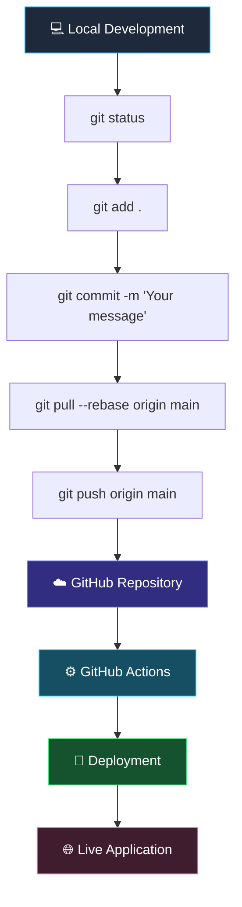

 
<!-- ================================================= -->
<!--       DIPANWITA SINGHA - GITHUB PROFILE           -->
<!-- ================================================= -->

<div align="center">


<br/>

**Turning curiosity into code and ideas into innovation.**

[](https://github.com/DipanwitaSingha)
[](https://www.linkedin.com/in/dipanwita-singha-979a30380)
[](https://twitter.com/dipa39137)
[](mailto:dipanwitasingha673@gmail.com)


</div>

---
                                                           🧬CODED INTO EXISTENCE
Every coder has a plot twist. Mine started with curiosity and a questionable relationship with errors & 🐛💻. 
My journey is all about learning, experimenting, building via technology. Turning random into real-world solutions, one line of code & one error at a time. So far the time loop has produced documentations of learning procedures, Agentic RAG system for IP address, a loan approval system, Learning guide model for students. Different ideas, same mindset with a problem solving ideology

<div align="center">
  
</div>

## 👩‍💻 ABOUT ME | THE DEVELOPER BEHIND THE CODE

```python
class DipanwitaSingha:

    def __init__(self):
        self.name = "Dipanwita Singha"
        self.role = "Software Engineer"
        self.education = "B.Tech in Information Technology"

        self.languages = [
            "C", "Java", "Python",
            "JavaScript", "HTML", "CSS"
        ]

        self.technologies = [
            "React.js", "Django", "NumPy",
            "Pandas", "Figma", "Docker",
            "Git", "Artificial Intelligence"
        ]

        self.currently_learning = [
            "DevOps",
            "Machine Learning",
            "MySQL",
            "MongoDB",
            "Flask",
            "Oracle"
        ]

        self.interests = [
            "Full Stack Development",
            "Artificial Intelligence",
            "Software Engineering",
            "Data Science",
            "Problem Solving"
        ]

    def mission(self):
        return "Building meaningful technology through code."

    def ambition(self):
        return "Become an innovative and versatile Software Engineer."


developer = DipanwitaSingha()
print(developer.mission())
```

- 💻 A passionate Software Engineer focused on building practical and impactful digital solutions.
- 🧠 Interested in combining programming, intelligent systems, and modern software architecture.
- 🌱 Constantly expanding my knowledge of AI, Machine Learning, DevOps, and databases.
- 🎨 Exploring UI/UX design and creative development with Figma.
- 🔥 Regularly active on GitHub, exploring repositories, learning, experimenting, and improving my coding skills.
- 🚀 My goal is to become an ardent software engineer capable of turning complex problems into elegant solutions.

---

## 🧠 MY TECHNOLOGY ECOSYSTEM

<div align="center">

### ⚡ Programming Languages


### 🌐 Frontend & UI/UX Development


### ⚙️ Backend & Frameworks


### 🗄️ Database & Data Analytics


### 🤖 AI, Machine Learning & Intelligent Systems


### ☁️ DevOps & Development Tools


</div>

---

## 🚀 MY DEVELOPMENT JOURNEY

| Domain | Focus |
|---|---|
| Programming | C, Java, Python, JavaScript |
| Web Development | HTML, CSS, React.js |
| Backend Development | Django, Flask |
| Data Science | NumPy, Pandas |
| UI/UX | Figma |
| AI & ML | Artificial Intelligence, Machine Learning |
| Databases | MySQL, MongoDB, Oracle |
| DevOps | Azure , AWS , Kubernetes |
| Tools | Git, GitHub, Docker |

---

## 🛠️ PROJECTS & DIGITAL CREATIONS

<div align="center">

### 💡 Turning Ideas Into Reality

</div>

I believe the best way to learn software engineering is by building real-world applications, experimenting with new technologies, and continuously improving existing solutions.

**My project development interests:**

- 🌐 Full-Stack Web Applications
- 🤖 AI-Powered Applications
- 📊 Data Analysis & Visualization
- 🔐 Secure and Reliable Software Systems
- ⚙️ Automation and DevOps
- 💻 Problem-Solving Applications

> Every project is an opportunity to learn something new, solve a problem, and create something meaningful.

---

## 📊 GITHUB COMMAND CENTER

<h2 align="center">⚡ Git Command Center</h2>



<div align="center">

| Command | Purpose |
|:---|:---|
| `git init` | Initialize repository |
| `git clone` | Clone a repository |
| `git status` | Check file status |
| `git add .` | Stage changes |
| `git commit` | Save changes |
| `git pull` | Fetch and merge updates |
| `git push` | Upload changes to GitHub |
| `git log` | View commit history |

</div>

### 🐍 My Contribution Journey

<h2 align="center">📈 My Contribution Journey</h2>

<div align="center">
  
</div>


## 🎯 CURRENTLY EXPLORING | NEXT-GEN TECHNOLOGY

<div align="center">


</div>

```text
[01] MACHINE LEARNING
     └── Learning intelligent algorithms and predictive systems.

[02] DEVOPS ENGINEERING
     └── Exploring automation, deployment and CI/CD workflows.

[03] DATABASE TECHNOLOGIES
     └── Strengthening SQL and NoSQL database knowledge.

[04] BACKEND ENGINEERING
     └── Exploring Django, Flask and scalable architectures.

[05] ARTIFICIAL INTELLIGENCE
     └── Understanding how intelligent systems can solve real problems.
```

**My philosophy:** Never stop learning. Never stop building. Never stop questioning.

---

## 🏆 MY PROFESSIONAL MINDSET

- 💡 Innovation over imitation.
- 🧩 Problem-solving over memorization.
- 🔍 Understanding the logic behind every line of code.
- 🤝 Collaboration and continuous improvement.
- 📚 Learning new technologies and adapting to the evolving tech industry.
- 🚀 Building a career around curiosity, creativity, and engineering excellence.

---

## 🤝 LET'S CONNECT | BUILD SOMETHING AMAZING

<div align="center">

### Interested in technology, innovation, and collaboration?

I'm always excited to connect with developers, recruiters, mentors, and people who share an interest in building meaningful technology.

<a href="https://www.linkedin.com/in/dipanwita-singha-979a30380">

</a>

<a href="https://twitter.com/dipa39137">

</a>

<a href="mailto:dipanwitasingha673@gmail.com">

</a>

<a href="https://github.com/YOUR-GITHUB-USERNAME">

</a>

</div>

---

<div align="center">

### 💙 A LITTLE NOTE FROM MY DIGITAL WORLD

**"Code is not just about writing instructions for machines. It's about transforming imagination into something the world can use."**


<br/>

**Thanks for visiting my GitHub profile!**

⭐ If you find something interesting, feel free to explore my repositories.


</div>

<!-- END OF PROFILE README -->
